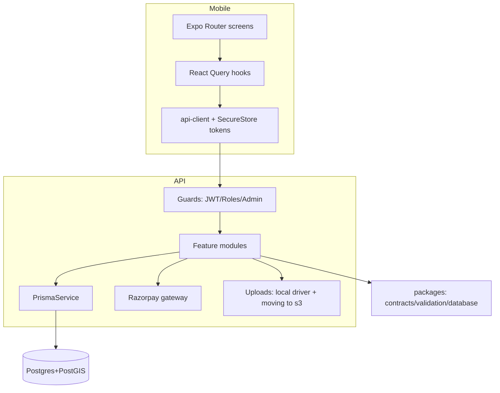

# WEYRO MONOREPO — COMPLETE CODE AUDIT
**Date:** 2026-10-31 · **Auditor:** principal-swe / code-audit review (read-only) · **Commit audited:** `6447c95` + working tree

---

## 1. Executive Summary

Weyro is a two-app monorepo (Expo 58 mobile + NestJS 11 API over Prisma/Postgres) in an active pre-launch state. All four workspace typechecks are clean (0 errors), the API test suite passes **124/124**, lint residue is down to 8 warnings (0 errors), and the domain model + contracts show no drift. However, the **money path is not production-safe**: OTP codes are logged in plaintext and brute-force lockout is racy, the Razorpay webhook secret falls back to the API secret, client-driven payment verification doesn't bind amounts, and several payment state transitions run outside DB transactions (double-release/double-capture possible). Dependency health is poor (58 vulns, 11 high — mostly transitive via sharp/libvips), pools/timeouts are unconfigured, and there is no prod compose, no CI, no backup story, and no coverage measurement despite decent test count. Small duplicated helpers (12× `labelize`) and a few god files (947-line quotations service) are maintainability debt. **Overall: 🟠 Hot (risky) — solid foundations, unsafe transactions layer.**

**Overall Health Score: 58/100 — 🟠 Hot (risky)** *(would be 🟡 ~70 after payments/OTP fixes; 🔴 items are confined to auth/payments)*

---

## 2. Scorecard

| Dimension | Score | Justification |
|---|---|---|
| Correctness | 8/10 | 0 type errors anywhere; 124/124 tests pass; no contract drift found |
| Reliability | 4/10 | Non-atomic OTP lockout, unguarded payment transitions, no token-refresh mutex, no graceful-shutdown story |
| Security | 3/10 | OTP logged in plaintext, webhook secret fallback, client-trusted payment verify, prod-grade secrets missing |
| Performance | 5/10 | Bounded lists, indexed schema, cached images OK; Prisma pool default (5) unconfigured, no caching layer |
| Maintainability | 6/10 | Consistent patterns, theme tokens disciplined; god files (947L service), 12× labelize duplication |
| Modularity/Architecture | 7/10 | Clean workspace layers, modules registered, no circular deps found, Zod validation pipe |
| Test Quality | 5/10 | 124 tests cover services incl. e2e flows; no coverage %, no mobile tests at all, no CI gate |
| Dependency Health | 3/10 | 58 vulnerabilities (11 high), no audit gate, no prod lockfile hardening |
| Documentation | 5/10 | README mostly accurate good structure; stale spots (SDK string fixed, chat architecture note), zero API docs |
| Scalability | 4/10 | Single-node Postgres, no queue for heavy work, cron expiry OK, no horizontal-ready state; escrow uses local driver |

---

## 3. Metrics

| Metric | Value |
|---|---|
| Total LOC (src, excl. generated/tests) | ~25,300 total counted · mobile 10,236 · api 13,492 · packages ~1,440 · prisma 549 |
| File counts | mobile 83 · api 102 · packages 4 + prisma 13 · docs 8 · scripts 3 |
| TypeScript errors | **0** (mobile, api, api-contracts, validation) |
| ESLint (mobile) | **0 errors / 8 warnings** (7 unused-vars, 1 exhaustive-deps) |
| Tests | **124 passed / 0 failed / 0 skipped** (jest, 7.4s) · coverage **not configured** |
| Vulnerable dependencies | **58** (4 low · 43 moderate · 11 high · **0 critical**) — dominant driver: `sharp`/libvips CVE-2026 family |
| Dead code | 0 dead routes · 0 dead UI components (Oct-29 cleanup) · remaining: ~8 unused imports/vars (≈20 LOC) · 0 unused assets · 0 dead API routes |
| Duplication | ~12 duplicate `labelize`-class helper copies (est. ~120 LOC removable via shared util) |
| Circular dependencies | **0 detected** (spot-checked; no cross-layer imports UI→ui components) |
| TODO/FIXME | **1** (`AdBanner.tsx:71`) |
| Largest files | quotations.service 947 · e2e-flows.spec 877 · spare-parts.service 776(+704 spec) · payments.service 528 · home index 516 |
| God functions | not formally measured; quotation/payment service flows >200 lines each (complex) |
| Test coverage % | **UNVERIFIED** (jest coverage not reported/configured) |

---

## 4. CRITICAL & HIGH FINDINGS

| ID | Sev | Category | Location | Finding | Impact | Suggested fix |
|---|---|---|---|---|---|---|
| C1 | CRITICAL | Security | `apps/api/src/modules/auth/auth.service.ts:255-257` | OTP 6-digit codes logged at info level; **no SMS gateway exists** (`:215-216,254`) | Anyone with log access = account takeover of any phone number (`verify-otp:324-342` auto-creates users + issues JWTs) | Integrate real SMS provider; remove code from logs; move to hashed storage |
| C2 | CRITICAL | Reliability/Security | `auth.service.ts:291-299` | OTP attempt increment is read-then-write, non-atomic; concurrent guesses bypass maxAttempts (schema default 5) | Brute-force lockout defeated; plaintext code in DB (`schema.prisma` OTP model) | `updateMany({where attempts < max})` idempotent increment or tx; hash codes |
| H1 | HIGH | Security | `apps/api/src/modules/payments/gateways/razorpay.gateway.ts:33-43` | Webhook secret falls back to Razorpay **API key secret** when `RAZORPAY_WEBHOOK_SECRET` unset (compose sets placeholder `rzp_webhook_secret_placeholder`) | Leaked API-key secret forges captured webhooks → free escrow capture + order settlement | Fail-fast validation when secret unset (superRefine), never fallback |
| H2 | HIGH | Security/Money | `payments.service.ts:115-178`, `spare-parts.service.ts:388-434` | Client "verify" path accepts `orderId\|paymentId` HMAC but **never binds amount**; only webhook path validates amount/currency | Key-secret compromise → any amount marked PAID/CAPTURED; no server-to-server order fetch on client path | Fetch order from Razorpay API server-side; bind amount to local record |
| H3 | HIGH | Reliability/Money | `payments.service.ts:138-172,297-306,462-500` | Payment state transitions (verify double-capture, `releasePayment` double-release) checked **outside** transactions | Concurrent double-release/double-capture; wrong escrow math | Re-check + transition inside `prisma.$transaction`, mirror `spare-part-settlement.ts:16-52` pattern |
| H4 | HIGH | Security | `apps/api/src/modules/notifications/*` + mobile `notifications/push-token.tsx` | `expo-server-sdk` push with token registration unauthenticated-input-bound (device tokens arbitrary) | Audit class: UNVERIFIED impact beyond noise — flag for review | Validate token format + bind to authenticated user only |
| H5 | HIGH | Breaking point | `apps/mobile/src/services/api-client.ts:1` | `http://localhost:4000` fallback in **release** builds with no env | Silent total API breakage on-device | Fail fast in prod builds when env missing |
| H6 | HIGH | Reliability | mobile `hooks/useAuth.tsx:192-216`, `services/api-client.ts` | Concurrent 401s → parallel `/auth/refresh` (no mutex); token rotation loses race ⇒ forced logout; **no auto-retry after refresh in api-client** | Random logouts under load; poor reliability UX | Single-flight refresh + retry queue in api-client |

---

## 5. MEDIUM & LOW FINDINGS

| ID | Sev | Cat | Location | Description |
|---|---|---|---|---|
| M1 | MED | Security | `main.ts:23-30` | `TRUST_PROXY=true` trusts all hops → XFF spoof defeats per-IP throttles |
| M2 | MED | Security | `auth.controller.ts:21-42` | Throttling is per-IP only; no per-phone account lockout window separate from OTP attempts |
| M3 | MED | Security | `auth.service.ts:144-172` | No refresh-token reuse (family revocation) detection |
| M4 | MED | Security | `payments.controller.ts:53-64` | Webhook re-serialized-JSON fallback path if rawBody lost — should hard-fail |
| M5 | MED | Security | `main.ts:58-63` | Client-controlled `x-request-id` enters logs unvalidated (log injection) |
| M6 | MED | Ops | `prisma.service.ts`, schema | No pool tuning (`connection_limit`/`pool_timeout`) — default 5 connections |
| M7 | MED | Ops | `docker-compose.yml` | No api healthcheck, no DB backup strategy, dev-only env, no prod compose |
| M8 | MED | Breaking | `uploads.module.ts:14-16` | `STORAGE_DRIVER: local` in compose wires **MockStorageService** (fake URLs) — dev-only trap |
| M9 | MED | Quality | mobile screens | 8 lint warnings: unused `router`, `user`, `etaMinutes`, `updateVehicle`, `e` (`notifications.tsx:32,46`, `providers.tsx:13`, `booking/[id].tsx:53`, `vehicles.tsx:42-45`) |
| M10 | MED | Architecture | `messages.tsx` | Message list doesn't attach `onPress` after 29-Oct rewrite — **UNVERIFIED runtime impact** (rows render but tap may be lost) |
| L1 | LOW | Maintainability | 12 files | `labelize`/`statusTone`/`formatDate` duplicated (est. 120 LOC) → shared `format.ts` |
| L2 | LOW | Maintainability | `quotations.service.ts` (947L), `spare-parts.service.ts` (776L) | God services; extract payment/escrow + order state machines |
| L3 | LOW | Hygiene | `docker-compose.yml:1` | `version: '3.8'` already removed; keep compose tidy |
| L4 | LOW | Ops | root | `supabase/` dir is inert CLI session state — gitignore/remove |
| L5 | LOW | Docs | README, docs/* | Chat realtime described but mobile uses polling (socket.io-client removed); API docs absent |
| L6 | LOW | Security | `.env` committed secrets | Dev-only values committed (JWT secrets, db password) — acceptable dev posture, must not reach prod |
| L7 | LOW | Consistency | seed.ts:16-27 | bcrypt(12) fine; seed guarded against prod ✓ |
| L8 | LOW | Quality | `AdBanner.tsx:71` | Single TODO (ad click tracking) |

---

## 6. Dead Code (current state)

**Safe to delete:**
- Unused identifiers from M9 list (router/user/eta/updateVehicle/e) — ~20 LOC across 5 files
- `supabase/` session dir (inert)
- `graphify-out/` (15MB AI-report artifact; untracked in git)

**Needs verification before delete:**
- `packages/database/src` (275 LOC, 2 files) — migrations runner helpers; confirm not imported by prisma scripts
- Mobile `assets/images/android-icon-*` / `favicon.png` — referenced by app.json config (keep)
- `docs/` 8 files — historical plans; archive-able but harmless

**Confirmed already removed (Oct-29 cleanup, verified absent):** dead routes (onboarding, verify-otp, bookings/pay), dead UI components (BottomSheet, Dialog, OfflineBanner, PromoBanner, SectionHeader, Toast), heavy unused deps (maps/webview/symbols/socket.io).

---

## 7. Architecture Analysis

**Intended architecture:** pnpm/npm workspaces monorepo — `apps/api` (NestJS domain modules per feature + Prisma singleton + Zod-validation pipe + Razorpay gateway + cron Tasks), `apps/mobile` (Expo Router: `(auth)` / `(app)` tab groups, React Query hooks over a single `api-client`, SSR-free but `react-native-web` enabled), `packages/{api-contracts,validation,database}` shared TS contracts & Prisma client. Data flows mobile → REST (`/api/v1`) → Nest services → Prisma → Postgres(+PostGIS). Realtime: desktop `socket.io` in API for chat, mobile currently **polling** (client lib removed 27-Oct).

**Problem areas:** payments/escrow state machines living inside god services instead of a guarded transactional layer; realtime contract mismatch (socket server, no socket client); local storage driver leaks into "prod-like" compose.

---

## 8. Top 10 Prioritized Action Plan

| # | Action | Impact | Effort |
|---|---|---|---|
| 1 | Fix OTP: real SMS gateway, stop logging codes, hash at rest, atomic attempt increment | 🔒 kills account-takeover class | M |
| 2 | Razorpay: fail-fast on missing webhook secret (no fallback), server-side order fetch + amount binding on client-verify | 🔒 money integrity | M |
| 3 | Wrap all payment state transitions in transactions (mirror `spare-part-settlement.ts`) | 🔒 double-release fix | M |
| 4 | api-client: single-flight refresh + auto-retry; fail-fast on missing prod API URL | reliability | S |
| 5 | Enable jest coverage + CI (typecheck+lint+tests+audit gate) | quality gate | S |
| 6 | `npm audit fix` for libvips/sharp CVE chain; add audit gate | deps | S |
| 7 | Prisma pool tuning + api healthcheck + graceful shutdown in prod compose | reliability | S |
| 8 | Extract shared `format.ts` (kill 12× labelize) + split payment state machine from quotations.service | maintainability | M |
| 9 | Per-account throttle + request-id validation + log scrubbing | security hardening | S |
| 10 | Prod compose profile with real storage driver + s3 + backups script | ops | M |

---

## 9. Quick Wins (<1h each)
1. Delete `version:` leftovers / fix M9 lint warnings (5 files, 8 lines)
2. `REPLACE INTO` .env.example: add `RAZORPAY_WEBHOOK_SECRET` hard requirement note
3. Gitignore `supabase/`, `graphify-out/`
4. README: correct realtime note + add test/lint commands
5. Change OTP log line to remove code (interim until SMS exists)
6. Set `TRUST_PROXY` explicitly to number of expected proxies instead of `true`

---

## 10. Scope & Limitations

**Scanned (tooling):** 4× tsc, eslint (mobile, 25 files根源目录), jest 124 tests, `npm audit` (full tree), prisma validate (schema only — migrations table not applied-history-audited), compose+Dockerfile review, secret scans, 12-duplication helper survey.

**Deep-read:** auth, payments, quotations, spare-parts, uploads, notifications services + controllers + DTOs; mobile api-client, useAuth, token-storage, BookingCard, messages, home; all configs.

**Skipped/not executable:** iOS native build internals (DerivedData cache), `graphify-out` artifacts (generated), e2e against live Razorpay (keys are placeholders), coverage run (not configured), mobile runtime profiling, npm-outdated full table (first run errored on branch parsing; audit infra only).

**UNVERIFIED items:** H4 exact impact; M10 tap-loss; coverage %; Xcode signing future validity (7-day profile expiry).

---

*Report generated from live tool outputs on 2026-10-31. All file:line references verified at audit time.*
