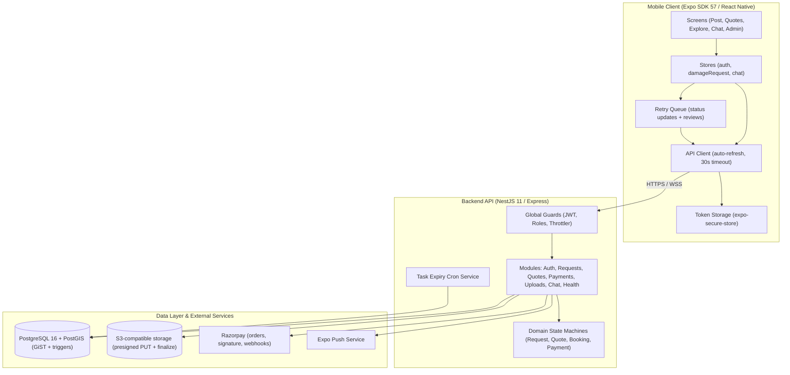

# Weyro 🚗🔧

> **Automotive marketplace connecting vehicle owners with workshops, garages, and spare-parts distributors in India.**

---

## 📌 Architecture & Overview

Weyro is an automotive marketplace for the Indian market: damage/repair requests,
quotations, bookings, INR (₹) payments through Razorpay, and spare-parts listings.
The mobile app is an Expo SDK 57 / React Native client. The backend is a NestJS 11
modular monolith backed by PostgreSQL 16 + PostGIS.



---

## 🚧 Implementation Status

| Feature | Status | Notes |
|---------|--------|-------|
| Email/password authentication + refresh rotation | ✅ Implemented | bcrypt, hashed refresh tokens, constant-time dummy compare |
| Role-based access control (CUSTOMER/PROVIDER/BOTH/ADMIN) | ✅ Implemented | Global guards + `@Roles()` |
| Damage request broadcast | ✅ Implemented | Nationwide feed; `ST_DWithin` radius when coordinates are supplied |
| Provider type / capability feed filtering | ✅ Implemented | Requests are matched to provider category, towing equipment, and max vehicle weight |
| Towing requests + distance-based pricing | ✅ Implemented | Pickup → dropoff distance; platform tariff (₹500 base + ₹40/km) with provider overrides |
| Live provider tracking + ETA | ✅ Implemented | `PATCH /bookings/:id/location`, `GET /bookings/:id/tracking`, Socket.IO `/tracking` namespace |
| Customer request history | ✅ Implemented | `GET /damage-requests/my` |
| Quotation submission & acceptance | ✅ Implemented | State machine, ownership checks, idempotent acceptance; towing quotes priced from distance |
| Booking milestones + tracking metadata | ✅ Implemented | `CONFIRMED → COMPLETED`; tracking number/carrier persisted |
| Customer reviews & ratings | ✅ Implemented | Provider `avgRating`/`totalReviews` recomputed |
| Razorpay orders, signature verification, webhooks | ✅ Implemented | Amount/currency checked; duplicate events ignored |
| Chat | ✅ Implemented (REST) | REST endpoints + JWT-authenticated Socket.IO gateway; mobile uses REST |
| Push notifications | ✅ Implemented (needs EAS project ID) | Tokens registered only when a real project ID is configured |
| Presigned uploads + size/MIME checks | ✅ Implemented | 10 MB limit, required `fileSize`, owner-scoped keys, `Content-Length` signed |
| EXIF/GPS stripping | ✅ Implemented | `POST /uploads/finalize` re-encodes with `sharp`; mobile calls it after upload |
| Provider verification | ✅ Implemented | Admin-gated, `verifiedBy`/`verifiedAt`/notes audit trail, DB-backed enforcement |
| Query/body validation | ✅ Implemented | Global Zod pipe; shared schemas in `@weyro/validation` |
| Rate limiting | ✅ Implemented | Global bucket + tighter per-route write limits |
| Health/readiness probes | ✅ Implemented | `GET /health`, `GET /ready` |
| Escrow capture/release | ✅ Implemented | Webhook capture + admin release with payout reference and audit log; gateway auto-payout is **planned** |
| Provider KYC document validation (GSTIN/trade licence) | 🟡 Partial | Documents field exists; validation workflow is **planned** |
| Phone OTP login | ✅ Implemented | `POST /auth/send-otp`, `POST /auth/verify-otp` |
| Private media + signed GET URLs | 🟡 Planned | Objects are served from `STORAGE_PUBLIC_URL` today |
| Request-level idempotency keys | ✅ Implemented | `Idempotency-Key` / `X-Idempotency-Key` interceptor + middleware |
| Soft delete + audit log | ✅ Implemented | `deletedAt` filters, `softDelete()` helper, `audit_logs` table |

---

## ⚡ Quickstart

Requires Node 22 (`nvm use`) and Docker.

```bash
# 1. Install all workspace dependencies from the repo root
npm install

# 2. Configure environment
cp .env.example .env

# 3. Start PostgreSQL + PostGIS
docker compose up -d

# 4. Generate the Prisma client and apply migrations
npm run db:generate
npm run db:migrate

# 5. (Optional) Seed development data
npm run db:seed

# 6. Start the API (terminal 1)
npm run start:dev -w @weyro/api

# 7. Start the mobile app (terminal 2)
npm start
```

The API listens on `http://localhost:4000/api/v1`. OpenAPI docs are available at
`http://localhost:4000/api/docs` **outside production only**.

For a native development build (required after adding native modules such as
`expo-location`):

```bash
npm run ios       # or: npm run android
# or in the cloud:
bunx eas-cli build --profile development
```

`eas.json` intentionally has no submit credentials until the App Store / Play
listing IDs are real, and `app.json` has no placeholder EAS project ID. Run
`bunx eas-cli init` to create the project before registering push tokens.

---

## 🧰 Scripts

| Command | Description |
|---------|-------------|
| `npm run lint` | ESLint (Expo config) |
| `npm run typecheck:all` | Strict typecheck for mobile + all workspaces |
| `npm test` | API Jest suites |
| `npm run build` | Build shared packages then the API |
| `npm run build:api` | Build only `apps/api` |
| `npm run db:generate` | `prisma generate` |
| `npm run db:migrate` | `prisma migrate dev` (local) |
| `npm run db:seed` | Seed the database |
| `npm run doctor` | `expo-doctor` |

Production migrations should use
`npx prisma migrate deploy --schema packages/database/prisma/schema.prisma`.

---

## 🇮🇳 India Market Localization

- **Currency**: INR (₹). Amounts are stored as `Decimal(10,2)` and converted to
  paise only at the Razorpay boundary.
- **Payments**: Razorpay orders, HMAC signature verification, and webhook
  processing. Amount and currency are validated against the stored payment.
- **Vehicles**: Indian makes/models in seed data.
- **Phone numbers**: stored in E.164 (`+91`) format; OTP login is supported.
- **Towing**: distance-based tariff in INR (₹500 base + ₹40/km, ₹500 minimum).
  Providers may override the base/per-km fee during registration.

---

## ⚙️ Environment Variables

| Variable | Description | Required | Default |
|----------|-------------|----------|---------|
| `NODE_ENV` | `development` / `test` / `production` | No | `development` |
| `DATABASE_URL` | PostgreSQL connection string with PostGIS | **Yes** | — |
| `PORT` | API listening port | No | `4000` |
| `JWT_ACCESS_SECRET` | Access token signing secret (32+ chars) | **Yes** | — |
| `JWT_ACCESS_EXPIRES_IN` | Access token lifespan | No | `15m` |
| `JWT_REFRESH_SECRET` | Refresh token signing secret (32+ chars) | **Yes** | — |
| `JWT_REFRESH_EXPIRES_IN` | Refresh token lifespan (`s`/`m`/`h`/`d`) | No | `7d` |
| `CORS_ORIGINS` | Comma-separated allowlist; `*` rejected in production | No | local Expo/web origins |
| `STORAGE_DRIVER` | `local` (mock) or `s3`; production must be `s3` | No | `local` |
| `STORAGE_BUCKET` | S3/MinIO bucket | Production | — |
| `STORAGE_REGION` | S3 region | No | `ap-south-1` |
| `STORAGE_ENDPOINT` | S3-compatible endpoint (MinIO) | No | — |
| `STORAGE_ACCESS_KEY` | S3 access key | Production | — |
| `STORAGE_SECRET_KEY` | S3 secret key | Production | — |
| `STORAGE_PUBLIC_URL` | Public base URL used for returned media URLs | Production | S3 URL |
| `RAZORPAY_KEY_ID` | Razorpay key ID | Production | — |
| `RAZORPAY_KEY_SECRET` | Razorpay key secret | Production | — |
| `RAZORPAY_WEBHOOK_SECRET` | Razorpay webhook HMAC secret | Production | — |
| `EXPO_PUBLIC_API_URL` | Mobile API base URL (must include `/api/v1`) | **Yes** for app builds | — |

Production startup fails fast if the required storage, Razorpay, JWT, or CORS
values are missing or unsafe.

---

## 🔐 Security & Operations Notes

- All mutating routes require a JWT; role and ownership checks run server-side.
- Providers must be `VERIFIED` in the database (not merely in a JWT claim) to
  read the broadcast feed or submit quotations.
- Webhook handlers reject missing event IDs, bad signatures, and amount/currency
  mismatches; raw request bodies are captured for HMAC verification.
- 5xx responses never include stack traces or internal error messages.
- Upload keys are scoped to the authenticated user and finalized through
  `sharp` to strip EXIF/GPS before the URL is persisted.
- `helmet` security headers, a strict CORS allowlist, `1 MB` JSON limits, and
  request-ID structured logging are enabled.
- Graceful shutdown drains connections (`enableShutdownHooks`).

---

## 🛠️ Verification & Testing

```bash
npm run lint
npm run typecheck:all
npm test
npx expo-doctor
```

CI (`.github/workflows/ci.yml`) runs lint, typecheck, and the API test suite
against a PostGIS service container.

---

## 📁 Repository Layout

```
weyro/
├── app.json                      # Expo app configuration
├── package.json                  # Workspaces: apps/*, packages/*
├── tsconfig.base.json            # Shared strict TypeScript base
├── .nvmrc / .editorconfig        # Node 22 and editor defaults
├── src/                          # Mobile app (Expo Router)
│   ├── app/                      # Screens
│   ├── components/               # Shared UI
│   ├── services/                 # API client, stores, upload helper
│   └── constants/theme.ts        # Design tokens
├── apps/
│   └── api/                      # NestJS API
├── packages/
│   ├── api-contracts/            # Shared TypeScript types
│   ├── database/                 # Prisma schema, migrations, geo queries
│   └── validation/               # Shared Zod schemas
├── docs/                         # AUDIT.md, SECURITY.md
├── .github/workflows/ci.yml
└── graphify-out/                 # Gitignored knowledge graph
```

The mobile app intentionally lives at the repository root (`src/`) rather than
under `apps/mobile`; the workspace layout keeps the API and shared packages
isolated without a disruptive move.

---

## 📱 Mobile UI

- `/` — Post a damage/repair request (photo upload, vehicle details, location)
- `/quotes` — Quotes, bookings, milestone tracking, reviews
- `/explore` — Provider feed (browse requests, submit quotes)
- `/chat` — Customer ↔ provider messaging
- `/auth` — Login/register with role selection
- `/admin` — Provider verification and marketplace overview

---

## ⚠️ Known Limitations

- Escrow release is recorded by an admin with a manual `payoutReference`;
  automated gateway transfers to provider accounts are not implemented.
- Media is served from a public CDN/bucket URL rather than short-lived signed
  GET URLs.
- Push notifications require an EAS project ID and a development/production
  build; web push is not registered.
- The chat client uses REST rather than subscribing to the Socket.IO gateway for
  live delivery.
- Live tracking shares foreground location only and displays ETA plus a
  last-updated timestamp; an in-app map view and background tracking are not
  implemented.
- GSTIN/trade-licence validation is planned.
