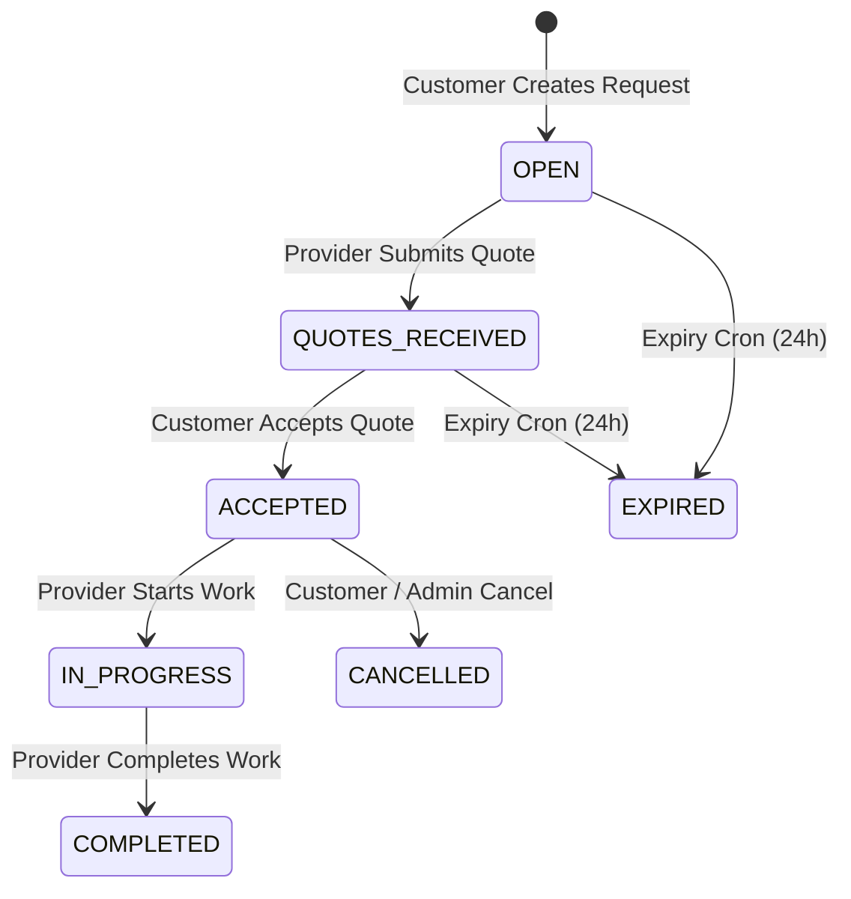
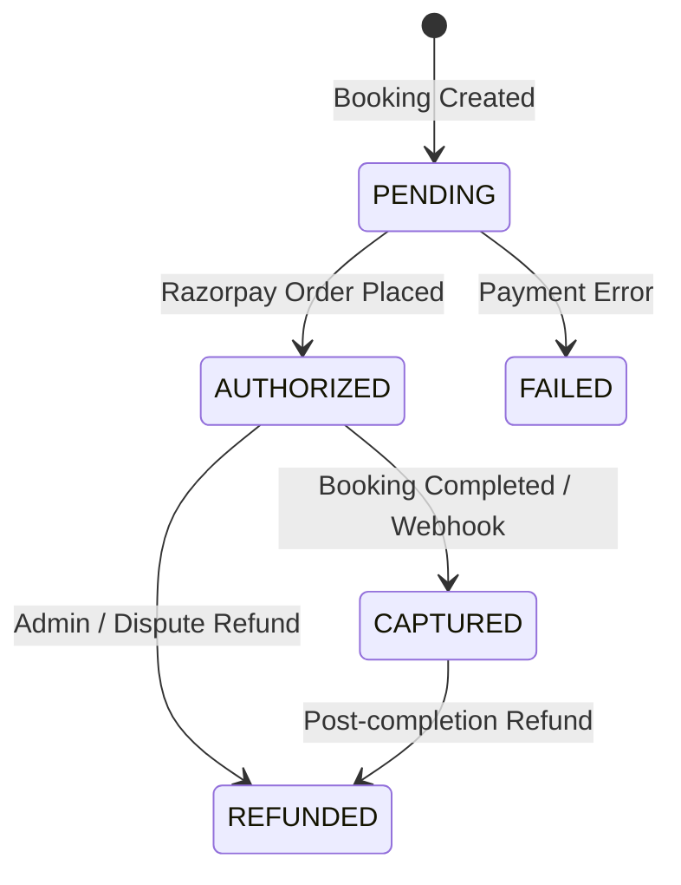

# Weyro Architecture Specification

## 1. System Overview & Monorepo Topology

Weyro is organized as an npm workspaces monorepo separating client, API server, and shared libraries:

```
weyro/
├── apps/
│   └── api/                     # NestJS 11 Modular Monolith
├── packages/
│   ├── api-contracts/           # Shared TypeScript interfaces & DTO contracts
│   ├── database/                # Prisma schema, SQL migrations & PostGIS spatial engine
│   └── validation/              # Shared Zod schemas with strict validation
├── src/                         # React Native mobile application (Expo SDK 57)
└── docs/                        # Architecture, Decisions (ADR), Security documentation
```

### Module Boundaries & Dependency Flow
- `packages/*` are leaf nodes with zero cyclic dependencies.
- `apps/api` consumes `packages/*` directly via standard workspace references.
- `src/` (mobile) imports contracts from `@weyro/api-contracts` and validation from `@weyro/validation`.

---

## 2. Domain State Machines

All critical business domain transitions are managed as pure, deterministic state machines in `apps/api/src/common/state-machines/state-machines.ts`:



### Payment State Machine


---

## 3. Spatial Queries & PostGIS Engine

Proximity calculations utilize PostGIS 16 spatial features rather than runtime trigonometric approximations:
- Native column: `geography(Point, 4326)` on `provider_profiles` and `service_requests`.
- Spatial Index: GiST indexes `provider_profiles_location_idx` and `service_requests_location_idx`.
- Trigger Sync: PostgreSQL trigger function `sync_geography_location()` automatically calculates `ST_SetSRID(ST_MakePoint(longitude, latitude), 4326)` whenever coordinates are inserted or modified.
- Queries: Executed with `ST_DWithin(location, ST_SetSRID(ST_MakePoint($lon, $lat), 4326), $meters)` for sub-millisecond bounding lookups.

---

## 4. Media Storage Architecture

Direct file uploads to the API process and local disk writes are completely decommissioned.
1. Mobile client requests a presigned PUT URL: `GET /api/v1/uploads/presigned-url?filename=...&contentType=...`.
2. Backend validates MIME types against strict allowlist (`image/jpeg`, `image/png`, `image/webp`, `image/heic`).
3. S3 SDK generates a 5-minute PUT presigned URL.
4. Mobile uploads directly from device to S3/Cloudflare R2/MinIO via HTTP PUT.
5. Permanent CDN URL is saved with the request.

---

## 5. Real-Time Chat & Push Notifications

- **WebSockets**: Implemented via `@nestjs/websockets` and `@nestjs/platform-socket.io` on namespace `/chat`. Handshake tokens are verified against JWT secrets; unauthorized clients are dropped immediately.
- **Room Isolation**: Clients join rooms named `thread_<threadId>`. `verifyParticipant` enforces that only the thread customer, thread provider, or platform administrators can join.
- **Push Delivery**: Background delivery powered by `expo-server-sdk`. Invalid tokens returning `DeviceNotRegistered` are automatically purged from the database.

---

## 6. Mobile Client Architecture

- **Token Security**: Tokens are saved in hardware-backed secure storage via `expo-secure-store`.
- **Resilient API Client**: Centralized `apiClient` manages automatic `Authorization: Bearer <token>` injection and intercepts HTTP 401s to perform stateful refresh token rotation seamlessly.
- **Offline Mutation Queue**: Mutations are stored in `AsyncStorage`. JWTs are attached at dispatch time (not queue time) with unique idempotency keys. Failed requests retry with exponential backoff (up to 5 attempts); unrecoverable 4xx client errors are dropped to prevent poison-pill locks.
- **Modular Screen Architecture**: All primary screens (`index.tsx`, `quotes.tsx`, `explore.tsx`, `admin.tsx`) are decomposed into small, typed components ≤ 220 lines each.
